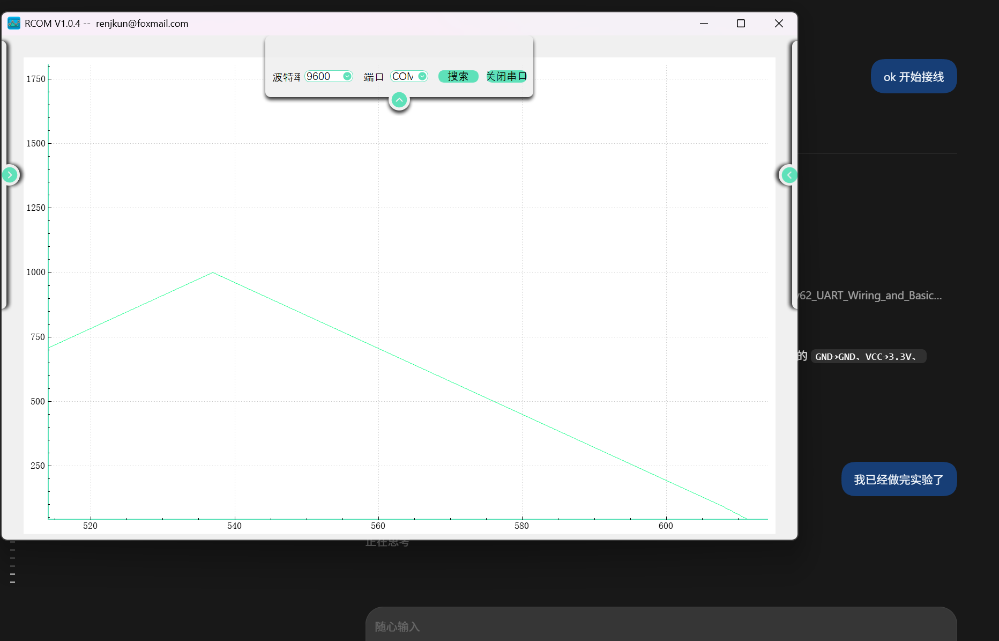
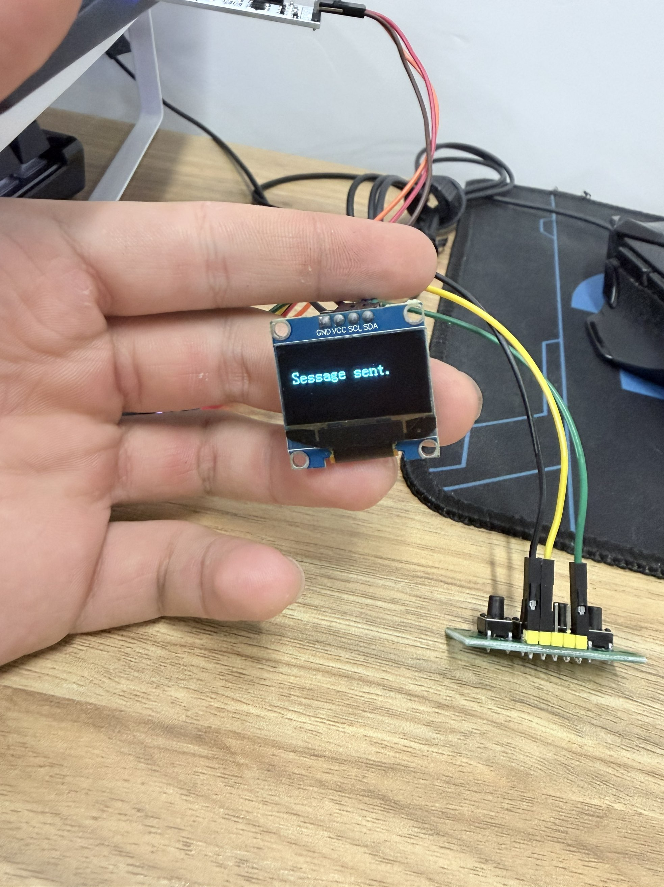
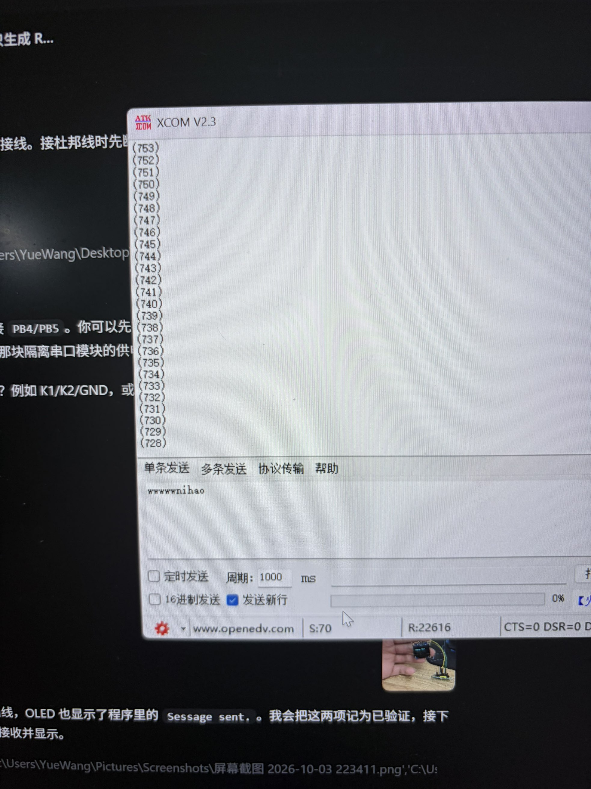
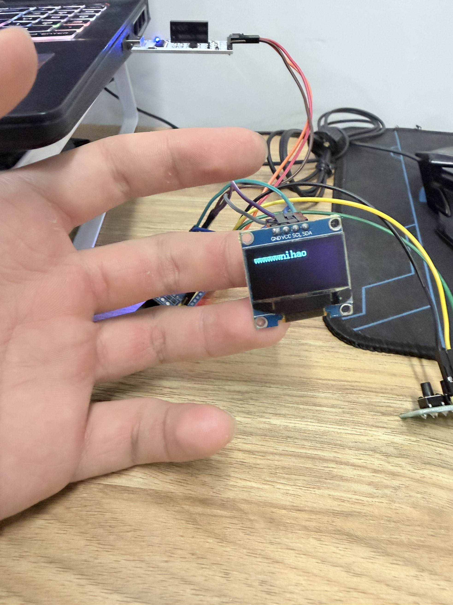
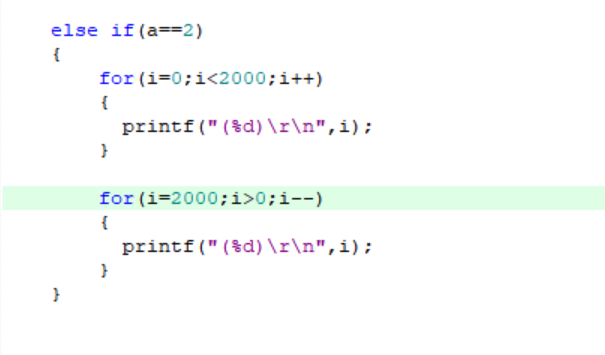

# Day62 UART 串口通信｜2026-10-03 学习记录（持续更新）

> 章节：第 3 章第一节，UART 串口通信  
> 今日状态：练习中（基础双向收发、OLED 显示与电脑绘图已验证；独立小修改与代码边界待验收）  
> GitHub 进度：仍属 Day62，待整节学习、实验和验收完成后统一整理  
> 上午会话：北京时间 11:28:44—12:46:01，跨度约 1 小时 17 分钟；不是精确的有效学习时长  
> 晚间会话开始：北京时间 22:29:45，结束时间待记录  
> 记录性质：上午学习与晚间实验持续记录；本节整体验收仍在进行

## 今天上午学到了哪里

上午继续阅读本节手册尾部与主循环，讨论了 `strcpy`、`memset`、字符串结束符、数组与指针，以及正常和异常输入的处理。STM32 板、OLED、USB 转串口模块和按键模块不在手边，计划晚上拿到快递后再做实物实验。

- C 字符串用 `\0`（NUL）表示结束，终止符也占一个字节。`strcpy` 从源字符串开始复制，连同最后的 `\0` 一起复制；它不会自动按目标数组大小限制复制长度。
- 对 `char text[20]`，在数组定义所在作用域中，`sizeof(text)` 是整个数组的大小，即 20 字节。作为 C 字符串使用时，最多保存 19 个数据字节，再留 1 字节给 `\0`，不是最多 19 个任意编码的文字字符。
- `memset` 按字节填充指定内存区域。`memset(&text, 0, sizeof(text))` 把 `text` 的 20 个字节全部置零，不只是把第一个元素清零。
- 数组作为普通函数实参传递时，通常转换成首元素指针；而本例在数组定义所在作用域中使用 `sizeof(text)`，得到的仍是整个数组占用的字节数。
- 对 `char a[10]`，普通表达式中的 `a` 指向首元素，类型为 `char *`；`&a` 指向整个数组，类型为 `char (*)[10]`。两者指向同一起点，但类型和指针步长不同：`a + 1` 跨 1 字节，`&a + 1` 跨 10 字节。

## 主循环的正常处理顺序

当 `USART_RX_STA` 的 bit15 为 1 时，当前工程依次执行：

1. 用 `strcpy` 把接收缓冲区中的字符串复制到 `text`。
2. 翻转 LED 状态，清 OLED 并显示 `text`。
3. 把 `USART_RX_STA` 清零。
4. 用 `memset` 清零 `text` 和 `USART_RX_BUF`。

状态值和缓冲区不是同一块数据：`USART_RX_STA = 0` 只重置状态、计数，不会自动擦掉 `USART_RX_BUF`。正常完成后的主循环会清缓冲区，但接收中断里的异常分支只清状态，因此不能把两条路径混为一谈。

## 接收代码的进一步手推

| 输入情形 | 依据当前代码推导的结果 | 原因 |
| --- | --- | --- |
| `HELLO\rX`，随后收到 `A\r\n` | 后一条可能被当成字符串 `AELLO` | `X` 使状态清零，但旧 `HELLO` 留在缓冲区；新 `A` 只覆盖下标 0，接收结束时又没有按新长度补 `\0` |
| 未结束的 `HELLO`，随后收到 `A\r\n` | 数据继续追加为 `HELLOA` | 没有收到完整 `\r\n` 时，软件仍认为这条消息未完成，写入下标继续往后走 |

这些结果是代码阅读和手推结论，不是实物实验结果；字符串显示还依赖后续存在有效的 `\0`。

今天进一步区分了两个“结束”：UART 每个字节帧中的停止位结束的是一个字节帧；本程序用 `\r\n` 判断一条软件消息结束。电脑分两次点击“发送”，不一定对应 STM32 收到两条消息；没有消息结束标志时，数据可能仍追加到同一条消息中。

## 待处理的代码边界

- `text[20]` 的容量边界：最多 19 个数据字节加 `\0`，当前 `strcpy` 没有目标容量检查。晚上的小修改需要考虑输入长度，不能因为接收缓冲区更大，就认为显示用数组也能容纳相同长度。
- 异常输入后的旧尾巴：下一条消息不能夹带上一条残留数据。可以考虑在正确位置补字符串终止符，或按实际接收长度处理，同时遵守目标容量限制。

上午只识别和推导了这些边界，没有修改代码，也没有声称问题已经修复。具体修改与验证留到晚上。

## 晚间实验结果

用户报告已完成实验，并陆续提供电脑绘图、串口助手和 OLED 实物照片。目前从这些图片直接确认：

- RCOM 使用 9600 波特率，显示了一段递增至约 1000、再递减至接近 0 的数字曲线，符合当前工程递增／递减发送示例的形状。截图是绘图窗口的一段，不能据此断言完整起始区间都在截图中。
- OLED 显示当前例程里的 `Sessage sent.`，确认已执行发送提示分支且 OLED 能显示文字。
- 新增 XCOM 照片可见英文发送内容（若干 `w` 和 `nihao`），未勾选十六进制发送、已勾选发送新行；对应 OLED 照片显示了这段英文内容，确认电脑到 STM32 的接收、消息结束判断和显示流程已经跑通。
- XCOM 接收区还能看到逐行递减的数值，如 `(753)`、`(752)` 等，与当前工程的绘图数据发送格式一致。
- 图片已保存到本节 `Evidence` 文件夹，保留原图内容。

基础实验部分已通过：STM32 向电脑发送数据、电脑向 STM32 发送文字、OLED 显示以及串口数字绘图均有实物结果。接下来完成独立小修改和已发现的两个代码边界检查。

## 独立修改：三角形数据峰值改为 2000（待实测）

用户提供的代码截图已把递增循环的条件改为 `i < 2000`，把递减循环的起点改为 `i = 2000`。两处修改相互匹配：预计依次发送 `0…1999` 和 `2000…1`，最高值为 2000。这仍是串口发送数字并由电脑绘图，不是输出模拟电压。

续验收时读取到原实验目录和本节归档目录的 `main.c` 均仍为 1000；截图证明编辑内容，尚不能确认已保存到哪一份工程。下一步先保存当前编辑文件，再编译、烧录并观察 K2 绘图结果。RCOM 的 Y 轴上限应高于 2000（例如 2500），避免峰值被显示范围截断。尚未收到峰值 2000 的实物曲线证据，暂不标记此项已验证。

后续更新（2026-10-04）：用户已提供峰值约 2000 的 RCOM 实测截图，独立修改的实物验收通过；原实验目录的 `main.c` 也已保存两个 2000 修改。本节归档代码仍保留旧版本，最终整理时需同步经验证的工程。详见 [2026-10-04 续验收记录](README_2026-10-04.md)。以上“待实测”保留为 10 月 3 日当时的状态。

## 来源与证据状态

| 来源 | 覆盖内容 | 状态 |
| --- | --- | --- |
| 2026-10-02 学习记录 | 本节已有进度与未完成实验 | 已确认，作为续学背景 |
| 当前工程的 `main.c`、`usart.c` | 主循环处理顺序、异常分支只清状态 | 已确认，仅代码证据 |
| 上午讨论与逐字节手推 | C 字符串、数组与指针、两类接收情形 | 已确认，仅阅读／练习证据 |
| RCOM 实验截图 | 9600 波特率与数字曲线 | 已确认，有图片证据 |
| OLED 实物照片 | `Sessage sent.` 发送提示 | 已确认，有图片证据 |
| XCOM 发送照片与 OLED 接收显示照片 | 反向收发、发送新行和英文显示 | 已确认，有图片证据 |
| 峰值改为 2000 的代码截图 | 两个循环的匹配修改 | 已确认，仅编辑截图；保存、烧录与新曲线待验证 |

| 项目 | 当前状态 |
| --- | --- |
| 本节尾部 `strcpy`、`memset`、数组与指针内容 | 已阅读，练习中 |
| 正常消息处理与异常输入的手工推导 | 练习中，已能解释关键差异 |
| STM32 向电脑发送数据并绘图 | 已验证，有 RCOM 截图 |
| OLED 显示发送提示 | 已验证，有实物照片 |
| 电脑向 STM32 发送文字并显示 | 已验证，有串口助手与实物照片 |
| 本次编译／烧录过程 | 未单独收集日志；实物程序已运行 |
| 独立小修改与预期现象对照 | 编辑截图已确认；保存与实物结果待验证 |
| 容量边界与旧尾巴问题的小修改 | 未开始 |
| 本节整体完成与验收 | 未完成 |

## 接下来完成验收

1. 独立完成一处小修改，并解释修改位置、预期现象和实际结果。
2. 处理和验证目标容量限制与异常旧尾巴，具体代码修改仍待进行。
3. 保存新的实验结果；如果出现无法解释的异常，先排查，再补充结论。

本节通过后补充整体总结和最终学习日期范围；今天学习结束时再生成当天口播。当前材料继续保存在 Day62 文件夹内，尚未执行 Git 提交、上传或推送。
