# Day62 UART 串口通信｜2026-10-04 续验收记录

> 章节：第 3 章第一节，UART 串口通信  
> 学习状态：已验证；本节约定的学习与实验验收通过  
> GitHub 进度：继续积累在 Day62，未执行提交、上传或推送  
> 学习日期范围：2026-09-30—2026-10-04；本记录结束本节验收，不自行宣布当天所有学习结束

## 独立修改与实测结果

用户自主把递增循环条件从 `i < 1000` 改为 `i < 2000`，把递减循环起点从 `i = 1000` 改为 `i = 2000`。

- 代码预期：发送 `0…1999`，再发送 `2000…1`，峰值为 2000。
- 已确认代码保存：原实验目录 `1.串口实验/USER/main.c` 的两个循环均已改为 2000。
- 实测：用户提供的 RCOM 截图显示波特率为 9600，绿色曲线升至约 2000 后下降，与修改预期一致。
- 证据范围：截图只显示峰值附近的曲线，不是从 0 到 2000 再返回的完整区间。串口发送的是数字文本，电脑据此绘图，不是单片机输出模拟三角波电压。
- 验收结论：独立修改与关键实物现象对照已验证。本次未单独收集编译／烧录日志，不据图片推断具体操作步骤。

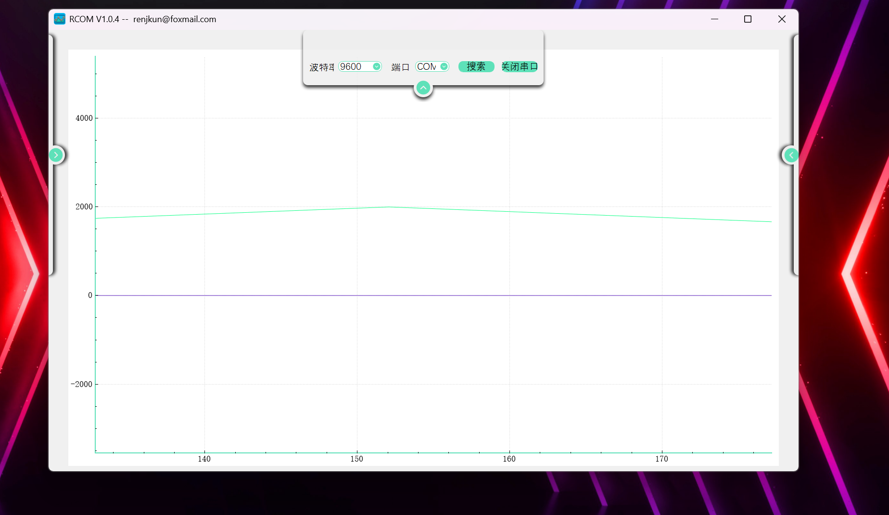

## 旧程序最小越界对照：20 个数字仍可显示

用户希望观察旧程序的越界表现，自主把接收显示的字号参数由 16 改为 8，再发送 `12345678901234567890`。源文件核对仍为 `char text[20]` 与原来的 `strcpy`，没有长度保护；小字号函数使用 6×8 字形，一行可以绘制 21 个字符，但这只是显示范围，不是数组容量。

- 现象：XCOM 截图中发送内容为 20 个数字，勾选发送新行；对应 OLED 实物照片显示了全部 20 个数字。
- 代码解释：若来源按正常路径以 `\0` 终止，`strcpy` 需要复制 20 个数据字节和 1 个结束符，共 21 字节。目标 `text[20]` 只有下标 0～19，结束符会被写到边界之外。
- 结论：本次画面可以正常显示，不代表复制操作安全。C 的越界访问没有固定的可见表现，也不保证当场报错或卡住。
- 未确认范围：未用调试器定位边界外写入的具体地址，不能断言“恰好是空内存”“某变量没有被改变”或“单片机自动保护了数组”。这不是异常已修复的证据。
- 后续：不继续扩大旧程序的越界量；先加入按有效长度限量复制并补 `\0` 的保护，再用同一条 20 字节消息对照。预期安全版仅保留 `1234567890123456789`，即前 19 个字节。

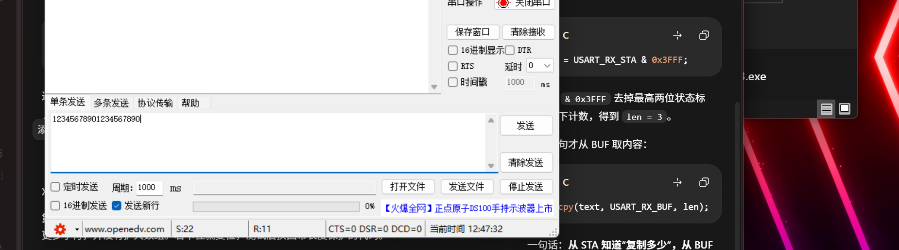

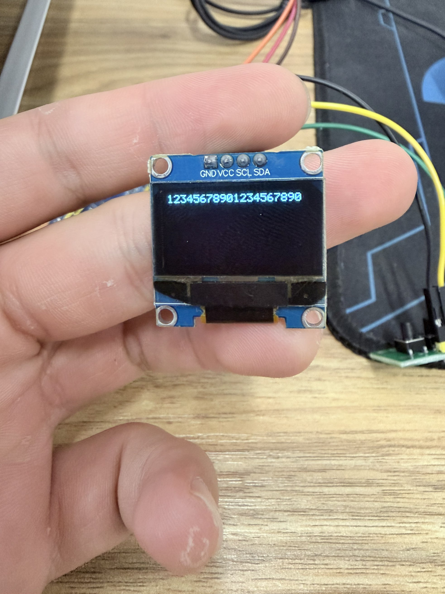

## 加入容量保护：发送 20 字节，仅保留前 19 字节

用户在 `main` 变量声明处增加 `u16 len`，注释原来的 `strcpy`，改为以下按长度处理的逻辑。两个代码截图与已保存的原工程源码均已核对：

```c
len = USART_RX_STA & 0x3FFF;
if (len >= sizeof(text))
{
    len = sizeof(text) - 1;
}
memcpy(text, USART_RX_BUF, len);
text[len] = '\0';
```

- 补充知识：`memcpy(目标, 来源, 字节数)` 按给定字节数复制，不会寻找或自动补字符串结束符。本例之后显式给 `text` 补 `\0`。
- 代码边界：`text[20]` 最多复制 19 个数据字节，结束符在 `text[len]`，下标不会超过 19。较短消息按实际有效长度复制，不把 BUF 的全部容量都复制过来。
- 实测输入：XCOM 发送 `12345678901234567890`，共 20 个数据字节；9600、8N1，文本发送，发送新行已勾选。
- 实测输出：OLED 显示 `1234567890123456789`，只保留前 19 个数字，符合修改预期。
- 验收结论：BUF 到 `text` 的限量复制与结束符保护已验证，不是“芯片自动保护内存”，也不是对所有接收并发与异常情况的完整保证。
- 额外已有证据：同一张 XCOM 截图接收区可见 `Hello!` 与 `1`，直接确认例程的文字发送输出。

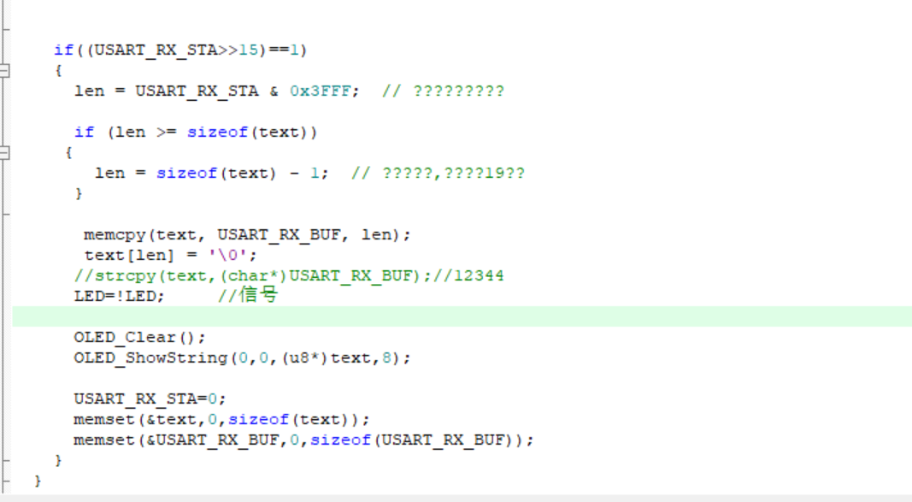

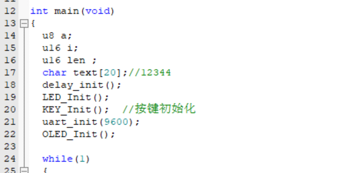

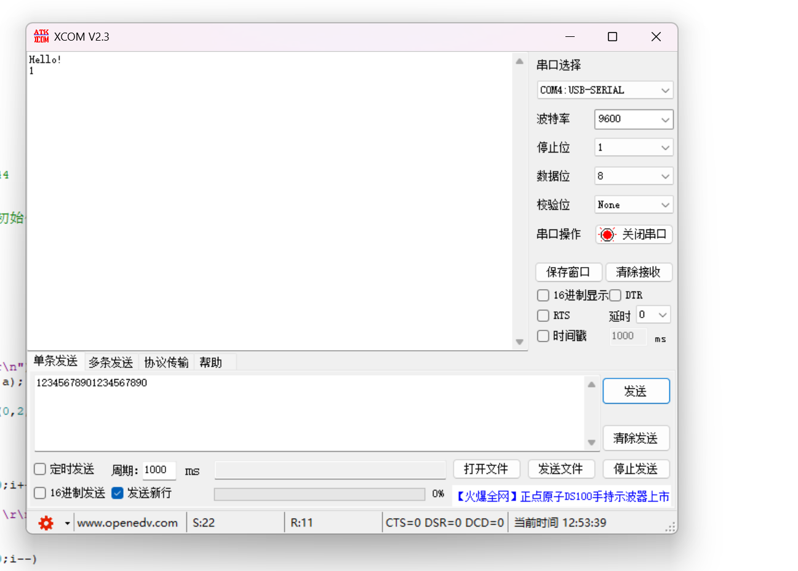

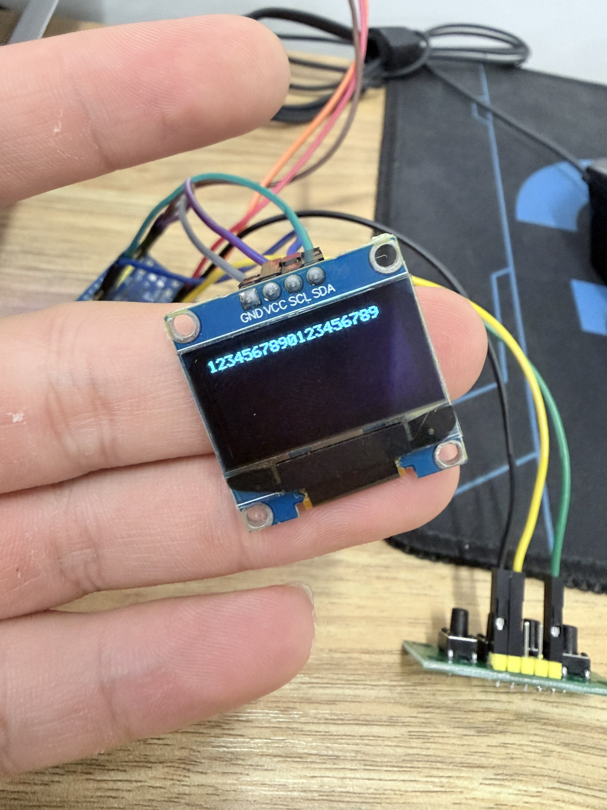

## 最后一项：异常消息后短消息不再带旧尾巴

用户提供两张 XCOM 截图和两张 OLED 实物照片，并报告现象与预期一致。按用户反馈和图片内容配对：

1. 使用十六进制发送、取消发送新行，发送 `48 45 4C 4C 4F 0D 58`，即 `HELLO\rX`。`X` 不是要求的换行字节，状态重置，不触发完整消息显示；OLED 仍显示先前的 19 个数字。
2. 再发送 `41 0D 0A`，即 `A\r\n`。这是一条完整的新消息，OLED 只显示 `A`，没有变成 `AELLO`。

原因：异常分支虽仍保留 BUF 的旧数据，新主循环只复制本次有效的 1 个字节，并在 `text[1]` 补 `\0`，所以显示字符串不包含旧尾巴。本次验证的是显示字符串的隔离，不是说错误消息后整个 BUF 当场都被清零。

结论：之前约定的旧尾巴显示检查已验证。基础双向收发、OLED、串口绘图、独立修改、容量保护和此项检查均已完成；第三章第一节按约定验收通过。

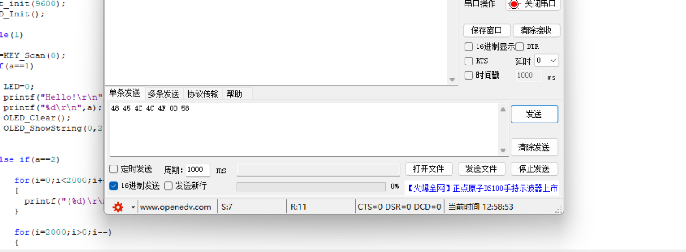

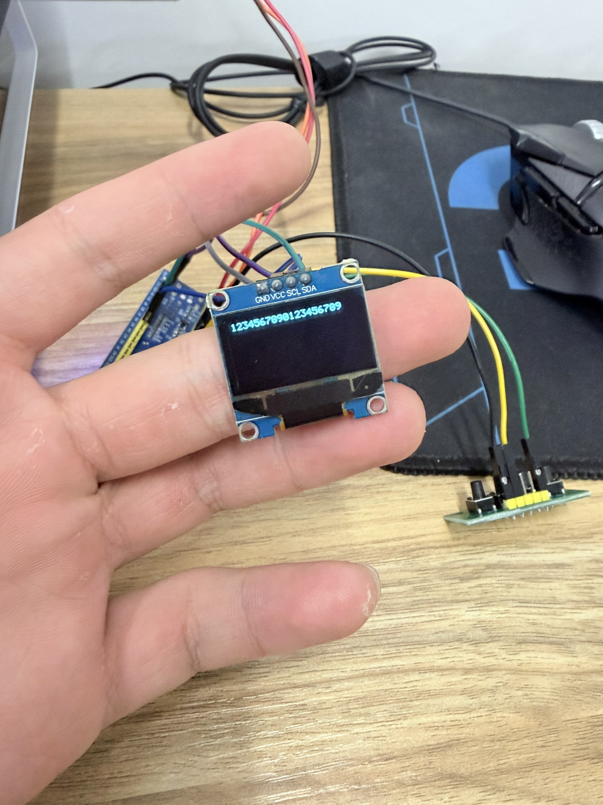

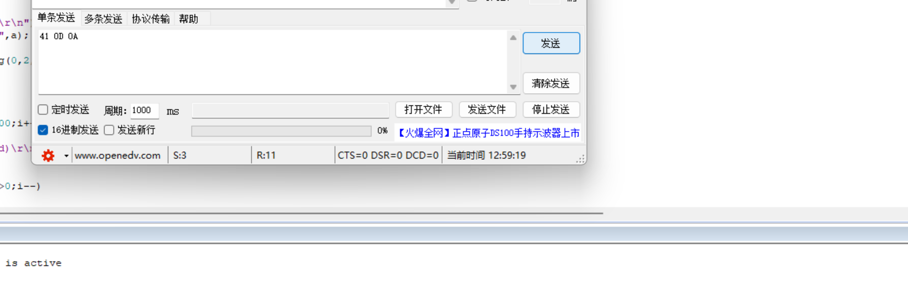

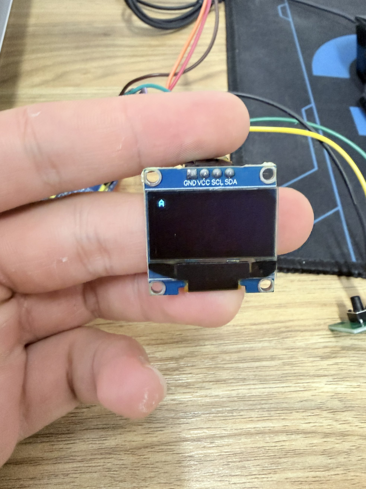

## 来源覆盖

| 来源 | 覆盖内容 | 状态 |
| --- | --- | --- |
| 2026-10-03 的代码修改截图 | 两个循环拟改为 2000 | 已确认，仅编辑证据 |
| 原实验目录的 `USER/main.c` | 两个循环已保存为 2000；`text[20]` 仍存在 | 已确认，文件证据 |
| 屏幕截图 2026-10-04 122651.png | RCOM 9600、绿色曲线峰值约 2000 后下降 | 已确认，实物运行结果 |
| 本节归档目录的 `Code/USER/main.c` | 保留原先 1000 版本，作为基线，不作为最终验证版 | 已确认，原例程未覆盖 |
| 屏幕截图 2026-10-04 124734.png 与对应 OLED 照片 | 旧程序发送、显示 20 个数字；发送新行已勾选 | 已确认，仅当前画面结果，不能证明容量安全 |
| 旧程序对照时的原实验目录 `main.c` | `text[20]`、原 `strcpy`、接收显示字号 8 | 已确认，仅当时的源码版本 |
| 屏幕截图 2026-10-04 125119.png、125123.png 与原工程后续保存的 `main.c` | 长度变量、14 位掩码、19 字节限量复制、显式结束符 | 已确认，代码证据 |
| 屏幕截图 2026-10-04 125341.png 与保护版 OLED 照片 | 发送 20 字节，只显示前 19 字节；XCOM 接收区还有 `Hello!` 与 `1` | 已确认，实物结果 |
| 屏幕截图 2026-10-04 125856.png、125921.png 与对应两张 OLED 照片 | 错误消息不更新；后续短消息只显示 A | 已确认，结合用户反馈配对 |
| `Code_Verified_2026-10-04` 完整工程快照 | 最终保存的峰值 2000、限量复制、显式结束符与小字号工程 | 已确认，133 个文件与源目录逐文件哈希一致 |

## 验收完成与适用范围

- 目标容量保护已修改并通过 20 字节输入的实物对照；不再使用没有容量限制的 `strcpy`。
- 中断异常分支仍只清状态，BUF 可能留有旧数据；新主循环按本次有效长度复制并给 `text` 补结束符，不再依赖 BUF 后面恰好存在 `\0`。旧尾巴显示问题已通过上述短消息实测。
- 本节验收已完成，不再追加 DMA、队列、中文显示或压力测试作为本节门槛；这些若需要，在后续学习另行安排。
- 本节结论针对当前单条消息的学习实验，不声称驱动已具备任意速率、连续并发消息下的完整可靠性。
- 不单独要求重交编译日志；本次保护版结果已运行，但尚未记录具体编译／烧录步骤。

## 后续整理

原例程 `Code` 保留不覆盖；实际验证工程另存为 `Code_Verified_2026-10-04`，133 个文件复制后逐文件哈希核对无差异，来源目录未修改。学习起止日期已注明在 [本节总结文件](README_Section_2026-09-30_to_2026-10-04.md) 名称中。当天口播仍在当天学习收尾时生成，计数独立于 GitHub Day62。尚未执行 Git 提交、上传或推送。
