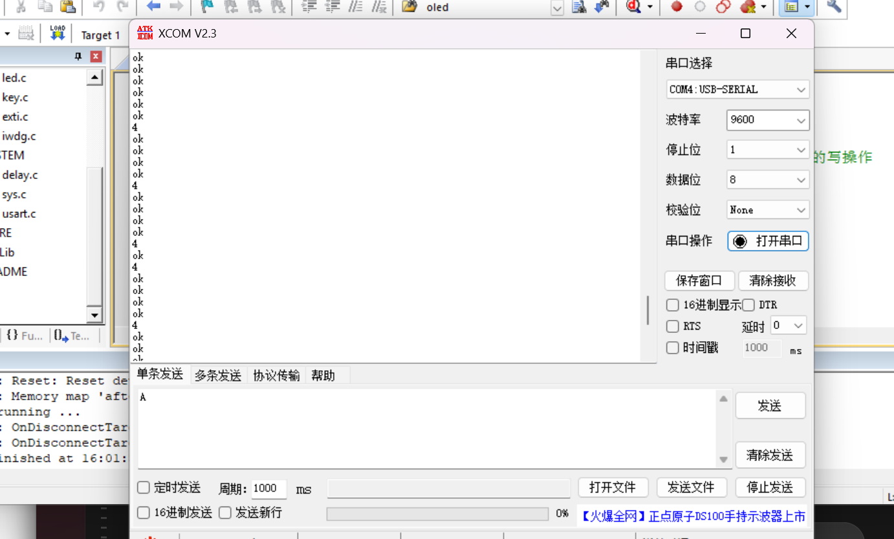

# 2026-10-06｜独立看门狗与窗口看门狗学习记录

手册范围：第三章第四节“独立看门狗和窗口看门狗（已精进）”。GitHub 小节材料为 Day65，抖音口播为第67天，两种编号分别管理。

标签：`STM32`、`外设`、`C语言`、`调试`。

## 1. 今日目标与完成情况

- 独立看门狗：理解倒计数、重装载、超时复位和参数编码；已完成用户确认的实物对比实验。
- 窗口看门狗：理解过早与过晚刷新、提前唤醒中断，并读懂初始化、主循环和中断服务函数；未做实物实验。
- 不把代码阅读当成实物验证，也不把标称时钟计算当成精确测量。
- AFIO 初始化顺序的旁支问题仍未闭环。用户已明确同意注明“原因待确认、尚未断电复测”后完成本次归档。

## 2. 独立看门狗：喂狗是在重新装载计数器

当前主程序在初始化时调用 `IWDG_Init(4,625)`，主循环依次执行：

```c
delay_ms(100);
printf("ok\r\n");
IWDG_Feed();
```

`IWDG_Feed()` 调用 `IWDG_ReloadCounter()`，库函数向键寄存器写入重装载命令 `0xAAAA`。这不是关闭看门狗，也不是每次重新初始化外设；它是将倒计数器重新装载为已经配置好的重载值。[本次工程实现](Code/IWDG/HARDWARE/IWDG/iwdg.c)

初始化函数本身也进行一次重装载，然后启动看门狗。主循环的喂狗语句才负责后续持续刷新。因此，去掉主循环里的 `IWDG_Feed()` 并不意味着“看门狗没有开启”；初始化仍然会开启它，后续无人刷新就可能超时复位。

### 参数与标称时间计算

- 第一个参数 `4` 是预分频寄存器的编码，二进制为 `100`，对应除以 64，不是除以 4。
- 第二个参数 `625` 是重载值，不是毫秒数。
- 以本节使用的 LSI 标称频率 40000 Hz 计算，分频后为 625 Hz，每个计数周期约 1.6 ms。

补充计算，计入 `RLR + 1` 个计数周期：

```text
超时时间 ≈ (重载值 + 1) × 分频系数 ÷ LSI 频率
(625 + 1) × 64 ÷ 40000 = 1.0016 秒
```

手册把它近似写成 1 秒。课堂中还正确计算了改成编码 `5`、即 128 分频时：`626 × 128 ÷ 40000 = 2.0032 秒`。以上都是标称频率下的计算，不是板上精确测得的超时时间。

独立看门狗使用芯片内部的 LSI，独立于主时钟；这不代表它独立于单片机本身，或不受供电、LSI 状态等条件影响。[ST 官方 STM32F1 IWDG 驱动说明](https://raw.githubusercontent.com/STMicroelectronics/stm32f1xx-hal-driver/master/Src/stm32f1xx_hal_iwdg.c)

## 3. 独立看门狗对比实验

接线沿用前一节：K1 接 PB4，按键模块与单片机共地；USB 转 TTL 的 TXD 接 PA10、RXD 接 PA9，并共地。串口助手采用 9600 波特率、8 位数据位、无校验、1 位停止位。复测时遵守原有供电方式和电平要求，不把 TTL 信号线当电源线使用。

| 对比情况 | 结果依据与记录 |
| --- | --- |
| 正常循环喂狗 | 串口收到多行 `ok`；截图记录接收历史，用户报告程序正常运行 |
| 错误中断入口的故障测试 | 用户确认按 K1 后 `ok` 输出暂停，随后恢复；按代码机制分析，为主循环不再喂狗后由 IWDG 超时复位、重新启动程序 |
| 恢复 `EXTI4_IRQHandler` 后 | 用户确认按 K1 能打印 `4`，并继续输出 `ok`；第二张截图能直接看到二者交替出现 |

故障测试的代码机制：PB4 产生 EXTI4 请求，但错误名称 `EXTI0_IRQHandler` 不能替代 EXTI4 入口；没有正确实现对应入口时，程序可能进入启动文件的默认处理循环，主循环无法继续执行喂狗。IWDG 已开启且供电、计数时钟正常时，超时由硬件直接触发复位，不需要 CPU 执行“复位服务函数”。

恢复正确的 `EXTI4_IRQHandler` 后，按键服务函数执行结束会返回被中断的位置继续运行，不是每次按键都从 `main` 开头重跑。硬件复位也不会修好源代码中的错误，再次触发同一错误仍可能重复故障。

证据边界：故障后暂停与恢复的连续过程以用户测试反馈为依据；静态截图不能单独证明暂停时长或复位来源。本次未记录精确时长和 RCC 复位标志，不将“约1秒”写成实测结论。

- [截图一：ok 输出历史](Evidence/2026-10-06_IWDG_OK_Output.png)
- [截图二：正确 EXTI4 入口后的 4 与 ok](Evidence/2026-10-06_IWDG_Correct_EXTI4_Output.png)



归档的 IWDG 工程现在是已经恢复正确入口的版本；本次整理未另外制造、修改或烧录一个故障版本。

## 4. 窗口看门狗：刷新必须在允许的时间窗口内

本次仅完成手册阅读、代码阅读与理解问答，没有上板验证 WWDG。

```c
WWDG_Init(0x7F, 0x5F, WWDG_Prescaler_8);
```

| 参数 | 含义 |
| --- | --- |
| 第一个：`0x7F`，十进制 127 | 启动时装入的倒计数初值 |
| 第二个：`0x5F`，十进制 95 | 窗口上界 W，与当前计数 T 比较 |
| 第三个：`WWDG_Prescaler_8` | 选择预分频配置，不是计数初值 |

手册把 `0x7F` 称为“第三个值”的位置存在笔误，按函数调用它实际是第一个参数。本次只在笔记中澄清，不改原手册或工程。

倒计数越大，说明离装载时刻越近；越小，说明已经过去更多时间。例如 W 为 95 时：T 为 110 时刷新太早；T 为 80 时在允许窗口内；若已减到 63，就已触发超时复位。这些例子不用于讨论 T 恰好等于 W 的边界。

补充知识：开启 WWDG 和提前唤醒中断后，计数到 `0x40`（64）可产生 EWI 请求；它不是暂停计数，也不要求 CPU 原本正在睡眠。若未及时刷新，下一次从 `0x40` 减到 `0x3F`（63）会触发硬件复位。WWDG 的计数时钟来自 APB1 的 PCLK1，并非 IWDG 那样独立于主时钟的 LSI。[RM0008 第20章](https://www.st.com/resource/en/reference_manual/cd00171190.pdf)

### 中断服务函数的三个动作

```c
WWDG_SetCounter(0x7F);       // 喂狗：重新装载计数值
WWDG_ClearFlag();           // 清除提前唤醒中断标志
PCout(13) = !PCout(13);     // 翻转 LED 状态
```

清除标志不是喂狗，也不会关闭看门狗。如果去掉第一句，即使后两句仍执行，也不能靠清除标志避免超时复位。[本次工程实现](Code/WWDG/HARDWARE/WWDG/wwdg.c)

### 补充知识：中断能喂狗，不等于主循环正常

这份示例的主循环只有延时和打印 `ok`，没有喂狗；喂狗发生在提前唤醒中断里。按代码逻辑推断：如果主循环卡在普通死循环中，但 WWDG 中断仍能及时执行并刷新计数，就不会仅因主循环卡住而超时复位；此时 LED 仍可能翻转，主循环却不再正常推进。

所以“在中断里无条件喂狗”不能作为主循环健康的证明。若要监控主循环，需要让喂狗与主循环确实完成正常工作有关。这里是使用策略的注意点，不能据此得出“窗口看门狗硬件没有用”的结论。本次不继续展开健康检查策略和精确窗口时间公式。

WWDG 源码状态需单独注明：`exti.c` 配置了 `EXTI4_IRQn`，却将处理 PB4/Line4 的函数定义为 `EXTI0_IRQHandler`。该名称不匹配仍存在，工程原样归档，既未在本次修正，也未实物验证。[对应源码](Code/WWDG/HARDWARE/EXTI/exti.c)

## 5. AFIO 旁支问题：保留为待确认

现象：用户报告，在未添加提前开启 AFIO 的语句时，下载后直接运行也能正常响应按键；尚未进行本次固件的完全断电、移除下载器后的独立上电对比。

源码核验：两个工程都先调用 `KEY_Init()`，再调用 `EXTIX_Init()`；`key.c` 仅先开启 GPIOB 时钟，随后调用关闭 JTAG、保留 SWD 的重映射配置；AFIO 的显式开启在后面的 `exti.c` 中，之后才进行 EXTI 来源映射。因此问题是“某次 AFIO 配置的调用顺序”，不是“整个工程从来没有开启 AFIO”。

一般初始化规范仍应在访问 AFIO 配置前开启其时钟。当前观察不等于“AFIO 时钟可以省略”，也不能证明库函数自动开了时钟、J-Link 自动完成了配置，或修改前配置在复位后必然保留。

调试记录：观察正常 -> 检查源码、构建与调试环境 -> 确认下载后直接运行、未独立断电复测 -> 原因仍待确认 -> 本次不改原工程 -> 用户同意保留不确定性后收尾。不能将这个旁支问题写成已查明原因或已完成修复，也不据此否定用户已确认的 IWDG 对比实验。

后续若要继续调查，可在断开下载器、全部供电及可能反向供电的串口连接后，完全断电，再独立供电对比；重新连接时遵守共地和电平要求。本次收尾不强制补做该测试。

## 6. 来源覆盖与归档边界

| 来源 | 覆盖内容 | 状态 |
| --- | --- | --- |
| 手册截图 `2026-10-06 151231.png` | 看门狗用途、IWDG 时钟与主循环喂狗 | 已确认 |
| 手册截图 `2026-10-06 151241.png` | IWDG 重装载、分频编码、故障演示与 WWDG 引入 | 已确认 |
| 手册截图 `2026-10-06 151253.png` | WWDG 主程序、服务函数与时序图 | 已确认 |
| 手册截图 `2026-10-06 151301.png` | WWDG 参数、分频宏与服务函数 | 已确认 |
| [IWDG 工程快照](Code/IWDG/USER/LED.uvprojx) | 当前初始化、主循环喂狗与正确 EXTI4 入口 | 已确认：源码；实验状态结合用户反馈 |
| [WWDG 工程快照](Code/WWDG/USER/LED.uvprojx) | 参数、EWI 内喂狗、尚存的 EXTI 名称不匹配 | 已确认：源码；未实物验证 |
| 两张实验截图及用户反馈 | IWDG 输出与故障/恢复对比 | 输出可见；连续过程与成功结论由用户确认 |
| ST 官方参考资料 | 独立时钟、硬件复位与 EWI 的补充核对 | 补充知识；不替代实验测量 |

手册截图完整文件名均以“屏幕截图”开头，原件位于用户的 Screenshots 文件夹；本次转化为学习笔记，不复制整本手册。实验截图已放入 `Evidence`，完整工程已放入 `Code/IWDG` 和 `Code/WWDG`，保留原文件字节与编码。旧构建产物只作快照，不代表本次重新编译或验证。

## 7. 收尾与下一步

本节必学目标已完成：IWDG 达到用户确认的实验验证层级；WWDG 达到概念理解和示例阅读层级。问答中已分清分频编码、喂狗与清标志、硬件复位与中断提醒，以及喂狗位置与主循环健康之间的区别。

精确 LSI 频率/超时时间测量、WWDG 实物实验和更深入的窗口公式暂未进行。下一节按手册顺序继续，未提前安排尚未提供的章节。

资料已在本地准备，GitHub 提交、上传或推送另需用户明确决定；本次未执行这些操作。抖音口播独立保存在 GitHub 目录之外。
