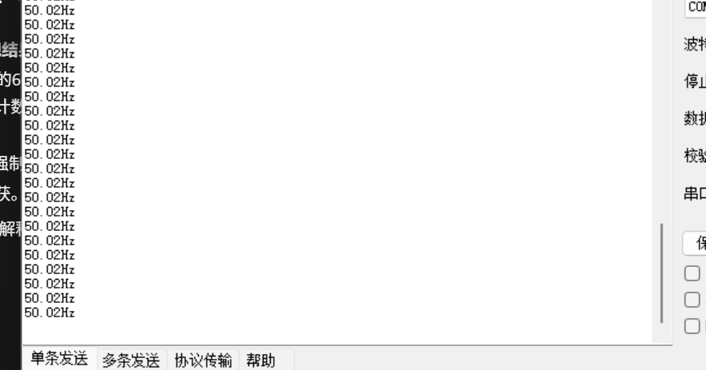

# 2026-10-13｜第九节输入捕获学习记录

GitHub归档编号：Day70。当天抖音口播编号：第72天。学习开始、结束日期均为2026-10-13。

标签：C语言、STM32、外设、硬件、调试、工具。

## 1. 本节状态与来源

当前状态：已验证，限定为本例50%占空比、标称50Hz PWM同板回环的正常测量路径。原理和代码主线已检查，本节按用户“出来了，收尾”的要求结束，不追加阅读或测验。

| 来源 | 覆盖范围 | 状态与边界 |
| --- | --- | --- |
| 屏幕截图 2026-10-13 200446.png | 目标、捕获原理、波形、主程序、初始化前半段 | 已确认手册内容；图中演示结果不当作用户实测 |
| 屏幕截图 2026-10-13 200455.png | 输入捕获参数、中断来源与入口 | 已确认；PA0的通道名称笔误已纠正 |
| 屏幕截图 2026-10-13 200505.png | 状态变量、中断分支、首次上升沿处理 | 已确认；用户先自行推演，再纠正关键理解 |
| 屏幕截图 2026-10-13 200514.png | 溢出累计、下降沿完成、频率换算 | 已确认；部分注释不能按字面当作真实行为 |
| 屏幕截图 2026-10-13 222602.png | 本次用户实物串口结果 | 截图范围内多行连续显示50.02Hz，无时间戳，不推出运行时长或误差统计 |
| 配套main.c、pwm.c、capture.c及工程配置 | 参数、引脚、寄存器读取、清中断与换算逻辑 | 已读取、原样备份；未独立留存实际烧录固件哈希 |
| 本次对话 | 用户自述分析、纠错与实物完成陈述 | 已确认；不扩展为独立编写完整驱动或所有边界场景已掌握 |
| ST数据手册与STM32F1官方定时器定义 | 引脚映射、输入选择与输入捕获分频 | 用于核实或补充，不冒充原手册完整讲解 |

## 2. 原理与配置理解

### 测量对象和适用前提

- 输入捕获是定时器功能。输入的有效边沿到来时，硬件把当时CNT保存到对应CCR寄存器，再由软件处理事件。
- 从上升沿到紧接着的下降沿，得到的是高电平持续时间，不是完整周期。
- 本例已知占空比为50%，所以周期等于高电平时间的两倍，频率等于周期的倒数。
- 用户能解释：未知占空比时，缺少高电平占周期的比例，不能只凭高电平时间确定周期和频率。

### 两个定时器的分工

TIM3负责产生待测PWM，TIM2负责输入捕获。按本例设计的72MHz定时器时钟：

```text
计数频率 = 72MHz / (71+1) = 1MHz
一个计数 = 1μs

TIM3周期 = (19999+1) × 1μs = 20ms
TIM3高电平时间 = 10000 × 1μs = 10ms
标称频率 = 1 / 20ms = 50Hz
```

1MHz是计数频率，不是输入PWM频率，也不代表每1μs触发一次捕获中断。用户能说明本例先捕获上升沿，在中断中切换为下降沿捕获，下降沿到来时再触发一次。

### 输入捕获参数

- TIM_Channel_1选择通道1；本例TIM2_CH1使用PA0。
- TIM_ICPolarity_Rising初始选择上升沿；后续由程序切换极性。
- DirectTI在本例将TI1输入送到IC1。
- TIM_ICPSC_DIV1表示每个符合所选极性的有效边沿都捕获。输入捕获DIV4则每4个有效边沿捕获一次，不把CNT时钟再除以4。用户已能区分它与计数器PSC。
- TIM_ICFilter=0x00不启用数字输入滤波；本次不背滤波编码，也未实测毛刺滤除能力。

### 中断来源与入口

本例TIM2的更新中断和CC1捕获中断共用TIM2_IRQHandler。函数内两个并列if检查不同来源，不是两个独立中断服务函数。

运行中的计数溢出产生更新事件，用于累计长高电平跨过的完整计数周期；CC1则对应当前极性配置下的通道1捕获事件，不固定代表上升沿。手册前文说更新中断对捕获“毫无意义”不准确，这份实现正是用它记录溢出次数。

用户能完成简化计数例子：从0开始、ARR=999，溢出一轮后捕获200，总计数为1000+200=1200。

## 3. 自行推演中断后的针对性纠错

用户提出先自己分析中断、再由辅导判断是否需要补读。实际采用逐项反馈，没有要求把整段手册重读。首次上升沿的清状态、清VAL、清CNT、置开始位、改为下降沿捕获等主线解释正确。

### 状态字与计数不是同一个量

| STA字段 | 含义 |
| --- | --- |
| bit7，掩码0x80 | 本次测量结束、结果待处理；也可能来自超量程强制结束 |
| bit6，掩码0x40 | 已捕获起始上升沿，正在等待结束下降沿 |
| bit5～bit0，掩码0x3F | 本次高电平计时期间处理的溢出次数，范围0～63 |

0x40本身不是“已经捕获下降沿”的标志。在CC1分支中，要结合已有开始状态、当前配置为下降沿及发生捕获事件，才判定这次为结束边沿。

用户最初把低6位视为未知、把两次普通溢出后的VAL写成126，之后明确普通溢出只累计次数，VAL不更新。又曾把整个STA说成溢出次数3，纠正为“低6位是3，整个字节还要保留0x40”。

```text
理论例子，不是本次50Hz实测：
开始：        STA=0x40，VAL=0
正常溢出1次：STA=0x41，VAL=0
正常溢出2次：STA=0x42，VAL=0
正常溢出3次：STA=0x43，VAL=0
```

用户随后能解释：若把整个STA误写成0x03，会丢掉起始上升沿建立的计时状态，使下一次CC1事件误走起始处理分支。这一纠错检查已通过。

### 超量程结束不是普通溢出，也不保证正常测量成功

普通溢出执行STA++，不是给VAL赋0xFFFF。第63次溢出把次数从62加到63；第64次更新到来时，发现已达63，才置结束位并人为把VAL填成0xFFFF，强制收尾。

这个VAL是人为填入的最大值，不是新捕获到的下降沿时刻，也不是“每溢出一轮的标记”。原代码没有用单独的状态位区分正常完成与这种强制结束，所以不能只凭0x80为1就认定正常捕获了完整脉冲。

置0x80不等于return，不会立即跳出当前执行，也不会自动关闭中断或停止计数。它决定下一次检查时是否进入测量主体；原工程在主体外仍执行清中断标志。

### 硬件锁存和软件读取分开

```text
下降沿到来 → 硬件将当时CNT保存到CCR1
随后进入中断 → TIM_GetCapture1读取CCR1 → 赋给VAL
```

TIM_OC1PolarityConfig(...Falling)只是选择捕获下降沿，不会立刻产生捕获。正常结束分支的VAL=TIM_GetCapture1(TIM2)读取已保存的CCR1，不是执行到该行时的实时CNT。该分支注释写“成功捕获到一次上升沿”是笔误，正常路径实际在处理下降沿。

用户能回答：下降沿瞬间CNT=10000，执行读取时CNT已到10005，返回的仍是捕获值10000。无需再逐段补读中断解析。

## 4. 频率计算与单位

用户自行解释了主要链路：取出溢出次数、乘完整计数周期、加最后一段捕获值、换算单位、利用50%占空比算周期并取倒数。

```text
N = STA & 0x3F
总计数 = N × 65536 + VAL
高电平时间（秒）= 总计数 × 0.000001
本例频率（Hz）= 1 / (高电平时间 × 2)
```

明确了以下细节：

- temp=STA&0x3F只是屏蔽高两位后把结果放入temp，不会修改STA本身。真正清软件状态的是最后STA=0。
- 一轮为ARR+1=65536个计数，不是把65535或其他数值当完整一轮。
- 加上VAL后的temp先表示总计数；本例每计数1μs，数值也等于持续了多少微秒，不应直接当秒。
- 最后清STA允许处理下一次起始边沿，不是重新初始化定时器或主动制造一次捕获。

上述掩码非破坏性、单位与重置语义已解释，没有为收尾再追加独立测验。也不把现有理解扩展为所有竞态、过捕获及恢复路径都已独立验收。

## 5. 实物验证

### 工程与接线方案

已核对配套工程：main使用uart_init(9600)，TIM3_PWM_Init(19999,71)，TIM2_Cap_Init(65535,71)，TIM_SetCompare1(TIM3,10000)。pwm.c将PA6配置为复用推挽输出；capture.c将PA0配置为下拉输入，并选择TIM2通道1直接输入。

| 连接 | 功能 |
| --- | --- |
| PA6 → PA0 | TIM3_CH1输出 → TIM2_CH1输入 |
| PA9 → USB转TTL RX | 打印频率 |
| STM32 GND → USB转TTL GND | 共地 |

串口设置9600、8N1，关闭十六进制显示。不需要发送命令；USB转TTL的TX、VCC不必接，STM32沿用原供电与下载方式。手册PA0写作TIM3_CH1的地方为笔误，本工程用PA0作为TIM2_CH1。

这些是代码核对与指导接线方案，本次未另外留存接线照片；实物完成以用户陈述和输出截图为证据。助手没有替用户编译、下载或改代码，未单独留存编译、下载日志。

### 现象与结论

现象：用户报告实验已出结果，并上传局部串口截图。

观察：截图范围内，多行连续显示50.02Hz，与本例标称50Hz接近。

结论：本次50%占空比PWM的正常捕获、频率换算和串口输出链路已跑通。显示与标称相差0.02Hz，约为标称值的0.04%；这是显示值与标称值的比较，不是独立标准源下测得的绝对误差，也未定位差值来源。

边界：TIM2、TIM3共用板上时钟，因此同板回环不能独立验证绝对时钟精度。标称高电平10ms小于TIM2一轮65.536ms，正常情况下不跨溢出，本次不能据此宣称溢出累计分支已实物验证。未实测超量程、同拍边界事件、过捕获、其他占空比或外部独立信号。

修改：无源码修改，保留正常实验基线。没有把小幅显示差值认定为故障，也没有用未经验证的原因解释它。本节按用户要求收尾，不因未开展精度和异常路径测试而强制追加实验。

### 实测截图



证据副本SHA-256：`B8AD81204821343CF0AD755BE4C747127DA7C9FF66ED51FE2682B3B0CA51B2C7`。副本与用户原图一致，没有重绘、合成或改动显示数值。

## 6. 归档与学习连续性

本节材料存放于Day70_Input_Capture，代码为Code/Input_Capture_Original中的原样快照。71个保留文件逐一SHA-256一致，Keil工程17个文件引用全部存在。这是归档完整性检查，不是助手重新编译通过的证明，也未独立核对烧录固件哈希。

仅保留学习所需源码、库文件、工程配置与原作者说明，排除旧OBJ、调试日志和界面缓存。保留原作者及库文件声明，未添加新许可证；公开完整第三方源码前仍需确认再分发许可。

后续辅导沿用本次有效方式：按知识依赖安排范围；用户先自行推演，依据实际回答定向解释、验收；已经讲清的段落不机械重读；普通代码问题放到整节知识结束后集中讨论，安全风险或严重影响核心理解的问题及时提醒。不默认添加新的实物测试或推进下一节。

## 7. 核实资料

- [ST STM32F103x8/xB数据手册：引脚及定时器资源](https://www.st.com/resource/en/datasheet/CD00161566.pdf)
- [ST STM32F1定时器官方定义：输入捕获选择及分频](https://github.com/STMicroelectronics/stm32f1xx-hal-driver/blob/master/Inc/stm32f1xx_hal_tim.h)

这里只准备本地README、原样代码、实验截图与独立口播，没有执行Git暂存、提交、上传或推送。
