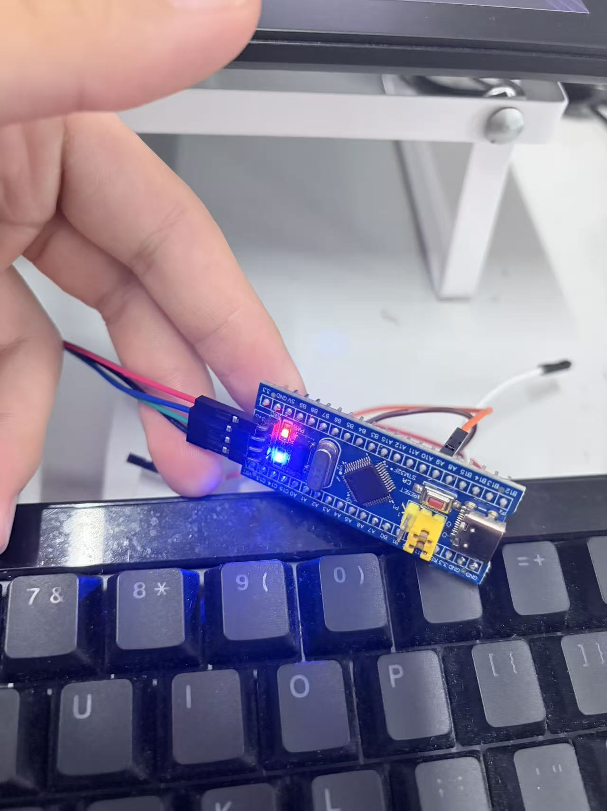

# Day71｜HAL与CubeMX：F103首个闪灯工程

学习日期：2026-10-14。对应手册第三章第十节“HAL库与CubeMX更进一步”，本节已完成。GitHub资料归档编号为Day71，当天抖音口播独立记为第73天。

今天完成了从标准库开发到CubeMX配置、HAL应用编写、Keil构建和J-Link下载的基础流程。用户确认板载LED可以正常亮灭，现有构建日志显示0错误、0警告。

用户明确确认本节已于2026-10-14全部学完，基础闪灯实验已验证，按完整章节归档为Day71_HAL_CubeMX。未逐项独立测验不代表本节未完成，也不将结课夸大为掌握全部HAL。本目录是本节的本地待上传资料，尚未提交或发布。

## 文件入口

- [当天详细学习记录](README_2026-10-14.md)
- [用户实物照片](Evidence/2026-10-14_HAL_LED_Hardware.jpg)
- [脱敏构建摘要](Evidence/Build_Summary_2026-10-14.md)
- [当前已验证版本的Keil工程](Code/HAL_LED_Verified/MDK-ARM/led.uvprojx)
- [CubeMX配置](Code/HAL_LED_Verified/led.ioc)
- [主程序](Code/HAL_LED_Verified/Core/Src/main.c)
- [GPIO初始化](Code/HAL_LED_Verified/Core/Src/gpio.c)
- [已补入工程引用的启动文件](Code/HAL_LED_Verified/MDK-ARM/startup_stm32f103xb.s)

照片记录了板上LED点亮的瞬间；“能够正常亮灭”来自用户的明确反馈。静态照片不证明闪烁频率、时序精度或长时间稳定性。

## 本次实际参数

| 项目 | 当前源码/工程记录 |
| --- | --- |
| MCU | STM32F103C8T6，工程设备为STM32F103C8 |
| CubeMX配置记录 | 6.13.0；项目选择STM32Cube FW_F1 V1.8.7 |
| Keil与编译器 | µVision 5.29；Arm Compiler 5.06 update 6，build 750 |
| 主时钟 | HSE，预分频1，PLL乘9，SYSCLK选择PLLCLK，AHB分频1 |
| 本例设计频率 | HSE按8MHz使用，SYSCLK/HCLK为72MHz |
| APB1与定时器 | PCLK1为36MHz，TIM2/3/4输入时钟为72MHz |
| APB2与定时器 | PCLK2为72MHz，TIM1输入时钟为72MHz |
| GPIO | PC13，推挽输出、无上下拉、低速；初始输出RESET |
| 应用逻辑 | PC13输出RESET，HAL_Delay(800)，输出SET，再HAL_Delay(800) |
| 计时基准 | 当前默认HAL实现使用SysTick，默认毫秒时基 |
| 实物结果 | 用户确认正常亮灭；一轮逻辑标称约1.6秒，未用仪器测量周期 |

当前SystemClock_Config只配置HSE/PLL，没有主动开启LSE。保存的.ioc仍记录PC14/PC15的LSE引脚角色，不能仅凭引脚颜色断言LSE实际在运行；下次重新生成时应复核配置意图与生成结果。

## 今天排除的三个阻塞

1. **F1固件包缺失**：CubeMX要求FW_F1 V1.8.7，本地当时没有安装F1包。之后继续生成并使用了该版本的工程。
2. **启动文件漏引用**：文件已经生成在磁盘上，但不在Keil项目文件列表中，导致链接器找不到RESET段并报L6236E。用户手动把现成启动文件加入工程，后续构建通过。
3. **JTAG/SWD不匹配**：下载日志明确显示JTAG selected。按SWD接线时，将J-Link设置中的Port改为SW后，用户完成下载并确认LED亮灭。

补启动文件不是每次构建都需要做的步骤。正常情况下CubeMX应自动生成完整工程；同一工程保存后不必反复添加。重新Generate Code会更新工程文件，需检查手动修复的引用是否仍然保留。

## 仍保留的不确定性

CubeMX日志在17:44的一次Keil工程生成中记录了路径解析异常：`java.net.MalformedURLException: unknown protocol: c`，之后17:47又有生成记录。本次确认了“启动文件漏引用”这一直接构建原因，但没有完成对生成异常触发条件的对照验证。不能直接认定由缺库、中文路径、Keil版本或某个确定的软件缺陷单独造成。

今天保留已经运行的基线，不为收尾重新生成、升级软件或追加实验。

## 归档范围与复现

- 原样复制255个工程所需源码、库文件、配置和RTE头文件，逐文件SHA-256一致；Keil工程17个源码引用全部存在且位于归档内部。
- 保留Core、STM32F1 HAL驱动、CMSIS核心头文件、STM32F1设备文件及其原有许可证。未复制无关CMSIS DSP/NN示例、文档和测试集。
- 不包含构建产物、原始构建日志、J-Link日志、账号信息、用户界面缓存、.uvoptx和JLinkSettings.ini。脱敏摘要单独记录成功构建信息。
- 重新打开工程的电脑仍需安装兼容的Keil STM32F1设备支持包及CMSIS组件。本次环境日志记录Keil.STM32F1xx_DFP 2.2.0、ARM.CMSIS 5.6.0，不把这些外部安装包视为已随目录打包。
- 用户本机下载器配置没有随归档复制：打开工程后确认Debug使用J-LINK/J-TRACE Cortex，Port为SW；Utilities可沿用Debug驱动，或独立设置同一驱动与SW接口。
- 接线或换线先断电。SWD使用PA13/SWDIO、PA14/SWCLK及共地，板子需正常供电；不把5V接到GPIO，不擅自叠加不明确的供电来源。

助手只读取当前工作工程并复制归档，没有修改原工程、重新编译、烧录或执行Git暂存、提交、上传、推送。
