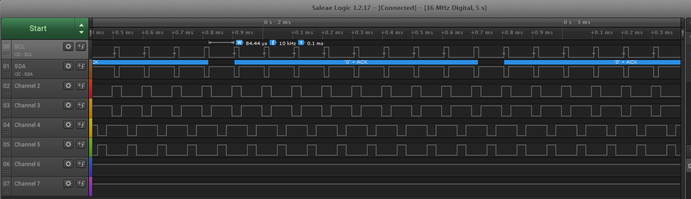
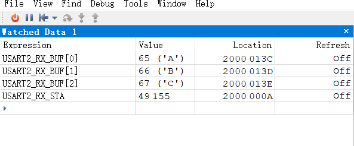

# 2026-10-16｜HAL定时器中断、互补PWM与串口接收

对应手册：第十一节“极速上手HAL库—基于STM32F407VET6”。实际开发板：STM32F103C8T6。今日口播：全局Day77，编号已由用户确认；另一个示波器复刻项目占全局Day76，不修改其项目内部编号。

标签：C语言、STM32、外设、协议、调试、工具、安全。

本章从2026-10-15开始，仍未全部完成。今日只整理本地日结、源码和实验截图，不推进GitHub章节Day编号，不提交、上传或推送。昨日记录保留当时的事实，今日新增状态不回写成昨日已完成。

## 1. 今日结果与验证边界

| 小节 | 当前状态 | 今日证据与边界 |
| --- | --- | --- |
| （5）定时器中断 | 已验证 | TIM2更新回调加入计数；Ozone读到tim2_irq_count=14805。证明回调执行；1ms来自配置计算，未独立精密测量中断周期 |
| （6）高级定时器互补PWM | 已验证 | 用户逻辑分析仪截图显示10kHz、0.1ms和六路三组互补波形；只是MCU逻辑信号测试，不是电机或功率桥实验 |
| （7）UART串口 | 中断接收已验证 | USART2收到ABC与CRLF；BUF前三字节65/66/67，STA=49155=0xC003。未实现或验证发送回显、连续多帧消费和错误恢复 |
| （3）编码器的补充代码 | 练习中，实物暂缓 | 今日main.c已加入TIM4溢出累计回调；与昨日未复刻回调的状态不同。仍无编码器/电机，不把新增代码当成硬件已验证 |
| （8）ADC、（9）GPIO输入与外部中断 | 未开始 | 今日原计划继续这两节，实际按用户要求收尾，留待下一次 |
| （4）sys.c | 缺失正文，跳过 | 不根据标题补造作者未提供的内容 |

今日出现的异常显示均已解释：UART的52/49/32、状态0xC00E及14来自发送内容和结束符差异；最终正确接收ABC。当前没有因这些结果遗留的未解释异常，也不要求为收尾重复已通过的实验。

## 2. 来源覆盖

下表截图文件名均以“屏幕截图 2026-10-16”开头。手册来源用于学习，不整节复制到公开资料；自己的证据截图另见[证据索引](Evidence/README_2026-10-16.md)。

| 来源 | 已确认覆盖 | 来源/归档边界 |
| --- | --- | --- |
| 115406.png | 剩余（5）～（9）目录与ADC子节 | 目录不等于正文已读，作者“完成”不等于用户完成 |
| 115908.png、115917.png | TIM2 Internal Clock、PSC/ARR、NVIC、更新回调和启动 | 作者F407参数需按F103实际时钟适配 |
| Edge/Ozone应用快照 | 回调位置、Ozone启动和变量观察过程 | 应用快照是当时状态，不当作持续实时画面 |
| 132906.png | 用户TIM2计数值14805 | 已复制；单张计数截图不独立证明精确中断频率 |
| 133128.png、133137.png、133153.png | 互补PWM手册整页、配置、启动与作者波形 | 整页小字不够可靠辨读的部分由后续清晰截图补齐，不猜读 |
| 134426.png、134435.png | 中心对齐、作者20kHz计算与约10kHz解释 | 证明作者是在演示改变计数模式后频率约减半，不能再称手册前后矛盾 |
| 141821.png、142652.png | 用户PSC=1、ARR=1800、中心对齐及F103引脚 | 已复制；参数截图与最终日结源码分别核对 |
| 143314.png | 用户六路互补PWM，界面标10kHz和0.1ms | 已复制；不自动把某段脉宽读成指定通道的高电平宽度 |
| 143505.png、144441.png、144453.png、144517.png | RCC/ADC受限选项、USART1不可用 | 结合保存的.ioc和重映射定义核对引脚冲突，不把所有黄色图标都当时钟故障 |
| 150058.png → 150105.png → 150113.png → 150120.png | UART模式、NVIC、一字节接收、CRLF算法与回调重装 | 按正文逻辑顺序阅读；作者USART3示例适配为USART2 |
| 154615.png、154806.png | XCOM初始发送与收到普通字符、0xC00E | 后者已复制；没有回显不等于接收失败 |
| 155120.png、155128.png、155226.png、155247.png | HEX模式、发送框编码内容及未完成帧 | 155226/155247已复制；区分HEX模式与发送框里真正输入的字节 |
| 155454.png | 最终BUF=ABC、STA=0xC003 | 已复制，用户明确确认与预期一致 |
| 当前.ioc、Core、HAL/CMSIS、Keil工程 | 收尾时保存的源码和工程依赖 | 原样快照；不宣称已认证芯片固件与快照逐字节相同 |

截图看不清时应明确指出位置，请用户放大或补发。今日对作者20kHz/10kHz的早先评价已根据清晰来源纠正；保留正确结论，不把助手的误读写成作者错误。

## 3. TIM2定时器更新中断

当前SYSCLK/HCLK为72MHz；APB1分频2，PCLK1=36MHz，TIM2输入时钟=72MHz。

| 参数 | 当前值与含义 |
| --- | --- |
| Clock Source | Internal Clock，使用内部时钟树供给；不等于系统必须使用HSI |
| PSC | 72−1=71，计数频率72MHz/72=1MHz |
| Counter Mode | Up |
| ARR | 1000−1=999，1000个计数间隔构成一次更新周期 |
| 更新周期 | 理论1000×1μs=1ms，即1000次/秒 |
| NVIC | TIM2使能，抢占优先级0、子优先级0 |
| 用户计数 | volatile uint32_t tim2_irq_count，在TIM2更新回调分支自增 |

调用链为：

```text
TIM2硬件更新事件
    → TIM2_IRQHandler()
    → HAL_TIM_IRQHandler(&htim2)
    → HAL_TIM_PeriodElapsedCallback(htim)
    → 判断htim->Instance == TIM2后自增计数
```

TIM4有自己的IRQ入口，但更新事件也能进入同一个HAL更新回调；Instance判断用于选择回调内的分支，不是到回调才决定进入哪个IRQ入口。

启动使用HAL_TIM_Base_Start_IT(&htim2)。该函数已经开启更新中断，当前源码紧随其后的__HAL_TIM_ENABLE_IT是冗余使能，未为归档擅自删除。先前重复嵌套的TIM2判断已由用户整理为一层。

### HAL_Delay与硬件计数的区别

HAL_Delay(800)让当前主程序停在等待循环内，不会关闭CPU或让整个MCU停住。当前工程由SysTick维护毫秒时间；TIM2硬件继续独立计数。TIM2中断到来后，CPU暂时处理IRQ/回调，再返回原来的等待位置。

PC13在等待期间保持上次写入的电平，不等于HAL_Delay本身控制高低电平。正常稳态、短回调条件下，等待800ms期间约有800次TIM2更新中断，而不是等待结束后集中执行800次。

不要把主循环中的可中断等待，推广为可以在当前高优先级TIM2回调中使用HAL_Delay。若SysTick不能抢占该中断，等待可能无法结束。

Ozone使用J-Link、SWD，加载Keil输出的.axf调试文件。Watched Data的5Hz只表示电脑端显示刷新频率，不改变TIM2中断频率。用户截图中的14805证明计数逻辑已运行，但不单独认证精确1ms周期。

## 4. TIM1三组互补PWM

TIM1位于APB2，当前输入时钟72MHz。最终参数为PSC=2−1=1、ARR=1800、Center Aligned mode 1、CKD No Division、RCR=0、ARR preload Enable。

补充知识：中心对齐的CNT在0与ARR之间往返；完整周期有2×ARR个计数间隔。不要把向上计数公式原封不动套过来。

```text
向上计数：fPWM = fTIM / [(PSC + 1) × (ARR + 1)]
中心对齐：fPWM = fTIM / [(PSC + 1) × 2 × ARR]

本例：72,000,000 / [2 × 2 × 1800] = 10,000Hz
理论周期：100μs
```

例如ARR=3时，0→1→2→3→2→1→0耗6拍，是2×ARR，不是8拍。PSC仍然按PSC+1分频，PSC=1意味着二分频。

用户明确目标是复刻作者约10kHz的波形效果，而不是要求中心对齐实际输出20kHz。最终填写ARR=1800，理论为整10kHz；之前讨论过ARR=1799可得到约10.006kHz的近似效果，但不是最后保存值。

作者先按向上计数公式计算20kHz，再解释切换中心对齐后测得约10kHz，这是演示过程，不是作者遗漏了减半解释。作者的PSC=4、ARR=1679按中心对齐精确计算约10.006kHz；不能仅凭界面简写10kHz区分这点小差别。

### 通道、引脚与实际CCR

| 通道组 | 主输出引脚 | 互补输出引脚 | 当前CCR | 主输出理论高电平占空比 |
| --- | --- | --- | --- | --- |
| CH1 / CH1N | PA8 | PB13 | 280 | 约15.56% |
| CH2 / CH2N | PA9 | PB14 | 560 | 约31.11% |
| CH3 / CH3N | PA10 | PB15 | 1280 | 约71.11% |

以上占空比按当前PWM1、High、中心对齐、零死区配置计算，不能写成逐项实测读数。CCR仍保留作者示例数值，没有按新ARR等比例缩放，因此只确认10kHz和三组互补效果，不说作者所有占空比都被精准复制。

主端分别调用HAL_TIM_PWM_Start；带N的互补端分别调用HAL_TIMEx_PWMN_Start。N不是另一个独立频率的定时器，它与对应CH共用该通道的比较设置。三组均已有启动调用。

用户逻辑分析仪显示六路三组互补，频率10kHz、周期0.1ms，用户确认正常。不根据旧的SCL/SDA名字或残留I2C解析标签认定正在进行I2C通信。



### 安全边界

当前DeadTime=0、Break禁用。今日仅验证MCU引脚逻辑波形，未连接或验证半桥/三相功率级、电机、死区保护、制动或故障关断。不能因为CH与CHN互补就直接认为功率管上下桥臂不会直通；实际功率级必须另行设计驱动、电平、死区与保护。

## 5. USART1为何不可用，改用USART2

串口异步通信不需要再占一个TIM定时器。当前限制来自同一个IO不能同时承担冲突的外设功能。

| 所需功能 | 引脚 | 当前占用 |
| --- | --- | --- |
| USART1默认TX/RX | PA9、PA10 | TIM1_CH2、TIM1_CH3 |
| USART1重映射TX/RX | PB6、PB7 | TIM4_CH1、TIM4_CH2 |
| RCC MCO时钟输出 | PA8 | TIM1_CH1 |
| ADC IN8、IN9 | PB0、PB1 | TIM3_CH3、TIM3_CH4 |
| SPI2常用信号 | PB13、PB14、PB15 | TIM1_CH1N、CH2N、CH3N |

图中黄色提示对应部分模式或通道受限，粉色行显示受限选项；不代表这些外设全部失效，也不能把RCC黄色标记直接当成HSE没有工作。MCO只是将时钟输出到引脚，当前不用。

当前改用USART2：PA2=TX、PA3=RX，Asynchronous，230400波特率，8位数据、1位停止位、无校验、无硬件流控；USART2 NVIC使能，优先级0,0。

## 6. 串口代码移植与接收流程

### 未定义错误：定义与使用没有统一改名

用户把回调中的USART3_RX_STA/BUF改成USART2_RX_STA/BUF，但文件顶部仍定义USART3_RX_STA/BUF，导致Keil报identifier undefined。

修正后usart.c顶部为：

```c
uint8_t USART2_RX_BUF[100];
uint8_t Res;
uint16_t USART2_RX_STA = 0;
```

USART2_RX_BUF/STA是用户自定义变量名，名字本身不绑定硬件，定义与使用必须一致；USART2与huart2才需要对应实际硬件和HAL句柄。不能把0x3FFF等位掩码中的数字3也机械替换成2。原代码能编译仅表示名字能对应，不自动表示已适配正确串口。

### 首次装载与回调重装

最初HAL_UART_Receive_IT(&huart2,&Res,1)被放在USART2_Init 0，此时HAL_UART_Init尚未执行。这个项目的首次调用不能建立接收；已由用户移到USART2_Init 2、HAL_UART_Init成功之后，之后编译通过。

```text
初始化串口
    → 主动调用Receive_IT，安排第一次一字节接收
    → 字节到来，HAL中断处理写入Res
    → 收满1字节后调用HAL_UART_RxCpltCallback
    → 用户代码读取Res、更新缓冲与状态
    → 回调末尾Receive_IT安排下一轮
```

Receive_IT只安排接收并返回，不会卡在初始化里等数据，也不是把数据存到函数“里面”。Res是指定的存储位置。回调是接收完成后的通知；如果第一次启动只写在回调中，就没有第一轮完成事件来触发它。

首次调用不强制必须在初始化函数内，但必须在初始化完成后主动执行。当前放在USART2_Init 2即可。初始化中的首次装载与回调末尾的重装不可混为同一句多余代码。

USART2_IRQHandler调用HAL_UART_IRQHandler(&huart2)，再由HAL在接收完成后调用共享回调。回调通过huart->Instance==USART2判断本次来源，不是用户在回调里重新实现硬件IRQ入口。

## 7. XCOM与Ozone接收实验

本次验证目标是USART2中断接收及CRLF组帧，不是发送或回显。接收接线要求USB转TTL的TX接PA3、GND共地；使用3.3V逻辑电平，避免把RS232电平或未确认的5V输出直接接入。开发板已供电时不额外盲接模块VCC；改线先断电。最终接线未提供照片独立核验。

### 调试记录A：看似“没反应”，实际收到数字文字

1. **现象**：最初Watch没有看到预期ABC；后续读到52、49、32，STA=49166。
2. **假设/测试**：对照XCOM发送模式、实际输入内容、结束符和Ozone刷新设置，而不是直接修改已工作的接收代码。
3. **观察**：最初未勾“16进制发送”，输入41 42 43 0D 0A；52、49、32分别是字符'4'、'1'和空格。
4. **结论**：发送的是14个普通字符。勾选“发送新行”又补入CRLF，所以状态49166=0xC00E表示正文14字节、已完成；不是错误码。

### 调试记录B：勾选HEX仍是旧文字的编码

1. **现象**：勾选HEX后的发送框变成34 31 20 34 32 20 34 33 20 30 44 20 30 41，前三个接收值仍是52、49、32。
2. **观察**：这串HEX表达的还是文字“41 42 43 0D 0A”，其中30 41是字符'0'、'A'，不是结束符0x0A。
3. **结论**：只勾HEX并没有让当前发送内容变成ABC；后来取消“发送新行”时，STA=14，表示正文14字节但未收到真正CRLF。
4. **修改**：保持HEX发送、关闭额外发送新行；清空原发送框，重新输入真正需要发送的41 42 43 0D 0A；复位并运行目标板，避免与上一帧状态混在一起。
5. **验证**：用户最终截图显示BUF[0]=65('A')、BUF[1]=66('B')、BUF[2]=67('C')，STA=49155，并明确确认与预期一致。

```text
发送的HEX字节：41 42 43 0D 0A
正文：ABC
结束符：CR LF

USART2_RX_STA = 0xC003
bit15 = 1：接收完成
bit14 = 1：已收到CR
低14位 = 3：正文长度3字节
```



Ozone的Refresh=Off表示运行时不自动刷新，暂停后读取仍可用于确认结果；如需动态观察，可设5Hz。界面刷新速度不是串口波特率或中断频率。

### 当前实现的局限

- 当前是单帧演示：完成标志置位后没有在main中消费并清除。HAL仍重装、接收后续字节，但已完成帧的数据分支跳过，后续字节不会组成新帧。再次完整测试需复位并运行。
- 没有发送/回显代码，所以XCOM接收窗口为空不是接收失败；PA2虽已配置TX，今日未验证发送方向。
- 未实现UART错误恢复、持续高负载收包或DMA接收；不把今天结果扩大成可靠连续全双工协议已完成。
- RX变量目前只在usart.c内部使用并由Ozone观察。若以后由main跨文件消费，需增加合适的声明，并考虑中断共享变量的volatile和同步；今天未为日结扩展实现。
- 100字节缓冲与CRLF算法适合本节短文本演示，不据此声称适合任意二进制参数协议。

## 8. 工程与证据归档

- [今日源码快照：Keil工程](Code/2026-10-16_HAL_TIM_CompPWM_UART/MDK-ARM/123321.uvprojx)
- [CubeMX配置](Code/2026-10-16_HAL_TIM_CompPWM_UART/123321.ioc)
- [主程序与TIM更新回调](Code/2026-10-16_HAL_TIM_CompPWM_UART/Core/Src/main.c)
- [定时器配置](Code/2026-10-16_HAL_TIM_CompPWM_UART/Core/Src/tim.c)
- [串口配置及接收回调](Code/2026-10-16_HAL_TIM_CompPWM_UART/Core/Src/usart.c)
- [IRQ入口](Code/2026-10-16_HAL_TIM_CompPWM_UART/Core/Src/stm32f1xx_it.c)
- [代码SHA-256清单](Code/2026-10-16_SHA256SUMS.txt)
- [证据索引](Evidence/README_2026-10-16.md)
- [归档核对摘要](Evidence/Archive_Check_2026-10-16.md)

原样复制209个代码、头文件、配置、工程及许可证文件，共18,694,389字节；8张自己的现存实验/配置截图按原字节复制。保留昨日快照，不覆盖历史记录。

不复制构建产物、Keil/J-Link原始日志、个人下载器设置或IDE缓存。助手没有修改工作工程、重新生成、构建或烧录，没有验证目标板固件哈希。源码依赖与哈希检查不等于重新编译成功。

本目录仍是本地待上传资料，不是已经发布的公开包。截图原样保留，部分含本地路径、用户名或无关聊天背景，公开前需要另行检查和裁去不相关内容；不直接批量上传原图。

## 9. 下次从哪里接着学

先接收8.1“单通道规则输入”的正文，从ADC开始继续；再按手册依赖推进8.2、8.3及（9）GPIO输入与外部中断，不预设F407配置适用于F103。

当前.ioc里ADC未启用分支的频率显示值为36MHz，不代表ADC已经配置正确或完成验证。下一次真正启用ADC时，应重新核对F103时钟限制、可用引脚和采样设置。

TIM4编码器方向、计数与溢出累计保留待实物条件具备后验证。无需为了收尾强制重测TIM1互补PWM或USART2已通过的单帧实验。

## 10. 补充知识核实依据

- [ST RM0008参考手册](https://www.st.com/resource/en/reference_manual/rm0008-stm32f103xx-advanced-armbased-32bit-mcus-stmicroelectronics.pdf)：计数时序、中心对齐和外设寄存器；公式按实际计数间隔推导。
- [ST STM32F103x8/xB数据手册](https://www.st.com/resource/en/datasheet/stm32f103c8.pdf)：时钟及引脚功能。
- [CubeMX官方界面说明](https://dev.st.com/stm32cube-docs/stm32cubemx/6.18.1/en/docs/markup/CubeMX_UserManual/chapters/04_4_stm32cubemx_user_interface.html)：引脚分配与冲突提示，不表示本机软件已升级至该文档版本。
- 本快照HAL_TIM、HAL_UART及GPIO重映射源码：核对Start_IT、Receive_IT、回调触发及引脚关系；原库没有为归档修改。
- [SEGGER Ozone调试说明](https://www.segger.com/products/development-tools/ozone-j-link-debugger/technology/efficient-debug-features/)：Watch、变量显示与运行中刷新。

来源之外的解释均属补充知识。今日用户实测、理论计算、磁盘代码状态与尚未完成的功能分别记录，不互相替代。
