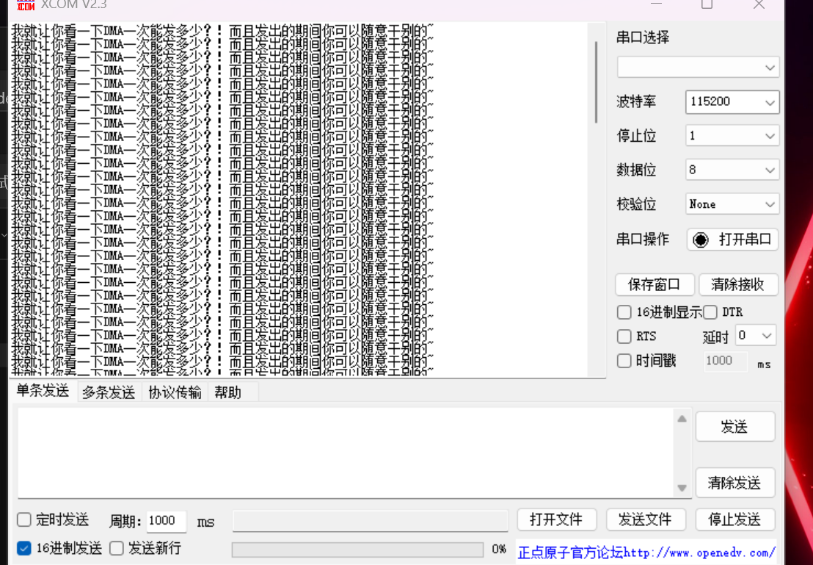

# 2026-10-31｜DMA串口发送实验依据

原图：`屏幕截图 2026-10-31 223345.png`。来自用户提供的截图，原样复制，未修改图像。

| 依据 | 本次可以记录的事实 |
| --- | --- |
| 截图 | 接收区重复显示测试文字，中文可读；参数为115200、8数据位、None校验、1停止位 |
| 用户确认 | 按一次K1发送一批，结束后停住，再次按下才再发一批 |
| 当前源码 | 按100行准备缓冲，DMA1通道4从text搬到USART1->DR，CPU在按键中断内轮询完成 |

单张截图没有覆盖完整接收数据，也不能单独证明按键触发过程。没有逐行清点、字节总数、完整串口导出、耗时测量或编译日志；不据此声称100行数据已逐字节无误验收。

抓图时界面显示“打开串口”，不将截图解释为当时端口仍打开。用户报告的接收实验结果与截图保留的内容按上述范围记录。
