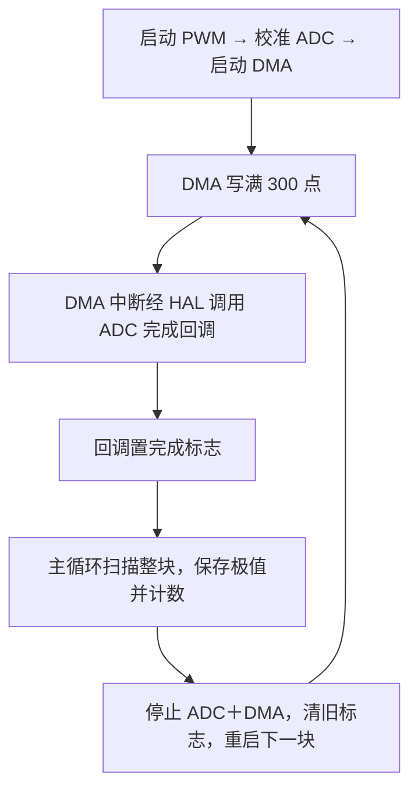

# STM32F103C8T6 ADC＋DMA Normal 分块采集样例

Day81｜2026-11-04｜STM32 100Days 的 DMA 章节补充样例

示波器项目第17天的采集代码整理为独立 Keil 工程。连接同一块板的 PA2 与 PA3，用 1 kHz、50% 的 PWM 验证 ADC1 能反复采集并处理 300 点数据块。下载后在 Keil Watch 中观察 `adc1_caiji`、`adc_min`、`adc_max`、`adc_blocks_processed`。

- 打开 [Keil 工程](Code/ADC_DMA_Normal/MDK-ARM/Oscilloscope_Rebuild.uvprojx) 编译。工程使用 ARM Compiler 5 和 STM32F1xx Device Pack。
- CubeMX 外设配置见 [.ioc](Code/ADC_DMA_Normal/Oscilloscope_Rebuild.ioc)，采集代码在 [main.c](Code/ADC_DMA_Normal/Core/Src/main.c)。
- 迁移到其他工程时，对照 [移植说明](PORTING.md) 检查 ADC、DMA、中断和 `USER CODE` 区。

| 模块 | 参数 |
| --- | --- |
| 回环源 | PA2／TIM2_CH3，PSC=71，ARR=999，CCR3=500 |
| ADC | PA3／ADC1_IN3，12 MHz，单通道，软件启动，连续转换，右对齐，采样时间 239.5 cycles |
| DMA | DMA1 Channel 1，Normal，外设到内存，两端半字，外设地址固定，内存地址自增 |
| 缓冲区 | 300 个 `uint16_t` 样本，600 字节，启动长度为 300 个传输单元 |
| 通知 | DMA1 Channel 1 中断，ADC 完成回调置 `adc1_complete` |

用户先在原工程的单块阶段看到极值 0、4095，随后在加入重启逻辑的版本中看到处理计数从 197 增至 720。两次观察之间增加 523 块，说明分块处理和重启能反复运行。计数截图用于验证处理进度。[实测记录](Evidence/2026-11-04/README.md)

整理版保留原来的采集、回调和重启顺序。为便于单独运行和移植，移除了 TFT 调用与驱动文件，保留原 .ioc 生成的 SPI 和 GPIO 初始化。样本数集中在一个宏里，极值改为便于 Watch 观察的整数变量，启动、校准、停止和重启调用加入返回值检查。整理版已在独立目录用 Keil 全量重建，0 错误、0 警告，生成 HEX。整理版的验证到构建为止，上板截图来自原工程。[整理版构建摘录](Evidence/2026-11-04/example-rebuild-output.txt)
